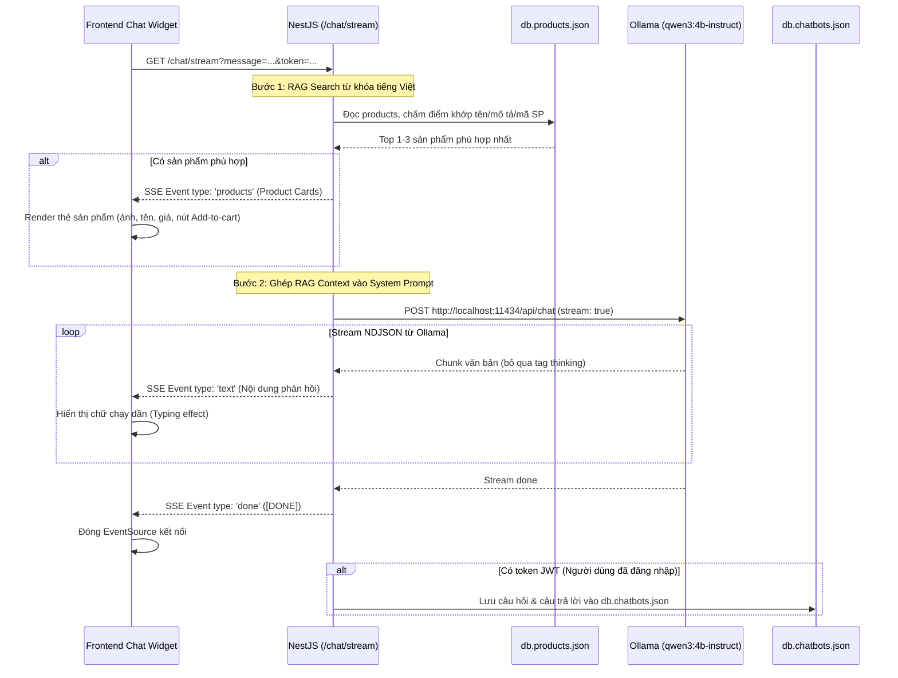

# Phân Tích Chi Tiết Backend LumiShop (NestJS)

> **Tài liệu thẩm định kỹ thuật dành cho Frontend & Product Team**  
> **Dự án**: LumiShop E-Commerce (Đèn bàn & Đồ gia dụng thông minh)  
> **Mục tiêu**: Nắm vững toàn bộ cấu trúc API, DTO, Data Model, luồng nghiệp vụ và giới hạn kỹ thuật của Backend trước khi thiết kế giao diện (UI/UX) và triển khai Frontend.

---

## 1. Bảng API Đầy Đủ (API Specifications)

Hệ thống backend sử dụng `NestJS` với `JwtAuthGuard` và `RolesGuard` kích hoạt toàn cục tại `AppModule`. Mọi route mặc định **đều yêu cầu xác thực JWT** trừ khi được gắn decorator `@Public()`.

| Module | Method | Endpoint Path | Quyền (Role) | Request Body (DTO) | Query Parameters | Response Data Type (Bên trong `data`) | Ghi chú quan trọng |
| :--- | :--- | :--- | :--- | :--- | :--- | :--- | :--- |
| **Auth** | `POST` | `/auth/register` | **Public** | `RegisterDto`<br>- `hoTen`: string<br>- `email`: string (email format)<br>- `sdt`: string<br>- `tenDangNhap`: string<br>- `matKhau`: string (>= 6 ký tự) | Không | `SafeUser`<br>`{ id, hoTen, email, sdt, diaChi, tenDangNhap, role, createdAt, updatedAt }` | HTTP 201. Mật khẩu được hash bcrypt. Role mặc định: `user`. |
| **Auth** | `POST` | `/auth/login` | **Public** | `LoginDto`<br>- `tenDangNhap`: string<br>- `matKhau`: string | Không | `AuthResponse`<br>`{ access_token, refresh_token, user: SafeUser }` | HTTP 200. Access token hạn 15m, Refresh token hạn 7d (lưu vào `db.refresh_tokens.json`). |
| **Auth** | `POST` | `/auth/refresh` | **Public** | `RefreshTokenDto`<br>- `refreshToken`: string | Không | `AuthResponse`<br>`{ access_token, refresh_token, user: SafeUser }` | HTTP 200. Cơ chế **Token Rotation** (thu hồi refresh token cũ, cấp mới bộ đôi token). |
| **Auth** | `POST` | `/auth/logout` | **Public** | `RefreshTokenDto`<br>- `refreshToken`: string | Không | `{ success: boolean, message: string }` | HTTP 200. Xóa refresh token khỏi database. |
| **Products** | `GET` | `/products` | **Public** | Không | `QueryProductDto`<br>- `page?`: number (>= 1, def: 1)<br>- `limit?`: number (>= 1, def: 10)<br>- `search?`: string<br>- `categoryId?`: string | `PaginatedProductsResult`<br>`{ data: Product[], total: number, page: number, limit: number }` | Tìm kiếm theo tên, mô tả, mã SP. **Không gửi param lạ** vì `forbidNonWhitelisted: true`. |
| **Products** | `GET` | `/products/:id` | **Public** | Không | Không | `Product`<br>`{ id, tenSP, moTa, giaBan, soLuongTon, hinhAnh, categoryId, trangThai, createdAt, updatedAt }` | HTTP 404 nếu không tìm thấy. |
| **Products** | `GET` | `/products/:id/recommendations` | **Public** | Không | Không | `Product[]` | Gợi ý tối đa **4** sản phẩm cùng danh mục đang bán (`DangBan`), loại trừ SP đang xem. Random fallback nếu thiếu. |
| **Products** | `POST` | `/products` | **Admin** (`admin`) | `CreateProductDto`<br>- `tenSP`: string<br>- `moTa`: string<br>- `giaBan`: number (>= 0)<br>- `soLuongTon`: number (>= 0)<br>- `hinhAnh?`: string<br>- `categoryId?`: string<br>- `trangThai?`: string (`DangBan` \| `NgungBan`) | Không | `Product` | HTTP 201. Tự sinh ID dạng `SPxxx`. Cần Bearer Token. |
| **Products** | `PATCH` | `/products/:id` | **Admin** (`admin`) | `UpdateProductDto`<br>*(Các trường tùy chọn của CreateProductDto)* | Không | `Product` | Cập nhật thông tin và ngày `updatedAt`. |
| **Products** | `DELETE` | `/products/:id` | **Admin** (`admin`) | Không | Không | `{ success: boolean, message: string }` | Xóa sản phẩm khỏi database. |
| **Categories** | `GET` | `/categories` | **Public** | Không | `QueryCategoryDto`<br>- `search?`: string | `Category[]`<br>`[{ id, tenDanhMuc, moTa, createdAt, updatedAt }]` | **Không phân trang**, trả về toàn bộ mảng. Tìm kiếm theo `tenDanhMuc`. |
| **Categories** | `GET` | `/categories/:id` | **Public** | Không | Không | `Category` | HTTP 404 nếu không thấy. |
| **Categories** | `POST` | `/categories` | **Admin** (`admin`) | `CreateCategoryDto`<br>- `tenDanhMuc`: string<br>- `moTa?`: string | Không | `Category` | HTTP 201. Tự sinh ID dạng `CAT + Date.now()`. |
| **Categories** | `PATCH` | `/categories/:id` | **Admin** (`admin`) | `UpdateCategoryDto`<br>- `tenDanhMuc?`: string<br>- `moTa?`: string | Không | `Category` | Cập nhật tên/mô tả danh mục. |
| **Categories** | `DELETE` | `/categories/:id` | **Admin** (`admin`) | Không | Không | `{ success: boolean, message: string, deleted: Category }` | Xóa danh mục khỏi file JSON. |
| **Customers** | `GET` | `/customers` | **User / Admin** (Auth) | Không | `QueryCustomerDto`<br>- `search?`: string | `SafeCustomer[]`<br>`[{ id, hoTen, sdt, email, diaChi, tenDangNhap, role, createdAt, updatedAt }]` | Không có phân trang. Tìm kiếm theo `hoTen` hoặc `sdt`. Password đã được lọc bỏ. |
| **Customers** | `GET` | `/customers/:id` | **User / Admin** (Auth) | Không | Không | `SafeCustomer` | Khách xem thông tin cá nhân hoặc Admin xem user. |
| **Customers** | `POST` | `/customers` | **User / Admin** (Auth) | `CreateCustomerDto`<br>- `hoTen`: string<br>- `sdt`: string<br>- `email`: string<br>- `diaChi?`: string<br>- `tenDangNhap`: string<br>- `matKhau`: string | Không | `SafeCustomer` | HTTP 201. Tạo KH mới (Mật khẩu băm SHA256, role gán `user`). |
| **Customers** | `PATCH` | `/customers/:id` | **User / Admin** (Auth) | `UpdateCustomerDto`<br>- `hoTen?`: string<br>- `sdt?`: string<br>- `email?`: string<br>- `diaChi?`: string | Không | `SafeCustomer` | Cập nhật profile (không đổi `tenDangNhap` và `matKhau`). |
| **Customers** | `DELETE` | `/customers/:id` | **User / Admin** (Auth) | Không | Không | `{ success: boolean, message: string, deleted: SafeCustomer }` | Xóa khách hàng khỏi database. |
| **Vouchers** | `GET` | `/vouchers` | **Public** | Không | `QueryVoucherDto`<br>- `page?`: number (>= 1)<br>- `limit?`: number (>= 1)<br>- `isActive?`: boolean<br>- `code?`: string | `PaginatedVouchersResult`<br>`{ data: Voucher[], total: number, page: number, limit: number }` | Có phân trang, lọc theo trạng thái và tìm kiếm gần đúng theo mã. |
| **Vouchers** | `GET` | `/vouchers/check/:code` | **Public** | Không | Không | `CheckVoucherResult`<br>`{ isValid: boolean, message: string, voucher: Voucher }` | Kiểm tra tính hợp lệ: `isActive`, `startDate`, `endDate`, `usageLimit`, `usedCount`. HTTP 404 nếu không tồn tại. |
| **Vouchers** | `GET` | `/vouchers/:id` | **Public** | Không | Không | `Voucher` | Chi tiết voucher theo ID. |
| **Vouchers** | `POST` | `/vouchers` | **Admin** (`admin`) | `CreateVoucherDto`<br>- `code`: string (duy nhất)<br>- `description`: string<br>- `discountType`: `'PERCENT'` \| `'FIXED'`<br>- `discountValue`: number (>= 0)<br>- `minOrderValue?`: number (>= 0)<br>- `maxDiscountAmount?`: number (>= 0)<br>- `startDate`: string (ISO date)<br>- `endDate`: string (ISO date)<br>- `usageLimit?`: number (>= 1)<br>- `isActive?`: boolean | Không | `Voucher` | HTTP 201. Tự sinh ID `VCxxx`. HTTP 409 nếu trùng `code`. |
| **Vouchers** | `PATCH` | `/vouchers/:id` | **Admin** (`admin`) | `UpdateVoucherDto`<br>*(Các trường tùy chọn của CreateVoucherDto)* | Không | `Voucher` | Cập nhật thông tin voucher. |
| **Vouchers** | `DELETE` | `/vouchers/:id` | **Admin** (`admin`) | Không | Không | `{ success: boolean, message: string, deleted: Voucher }` | Xóa voucher khỏi hệ thống. |
| **Orders** | `POST` | `/orders/checkout` | **User / Admin** (Auth) | `CreateOrderDto`<br>- `maKH`: string<br>- `diaChiGiao`: string<br>- `phuongThucTT`: `'COD'` \| `'ChuyenKhoan'` \| `'ViDienTu'`<br>- `items`: `[{ maSP: string, soLuong: number }]`<br>- `voucherCode?`: string<br>- `phiShip`: number (>= 0) | Không | `Order`<br>`{ id, maKH, diaChiGiao, phuongThucTT, items: OrderItemDetail[], tongTienHang, tienGiamGia, phiShip, tongTien, voucherCode, ngayDat, trangThai, paymentId, createdAt, updatedAt }` | Thực hiện **8 bước checkout**: kiểm tra tồn kho, tính tổng tiền, trừ tồn kho, tạo thanh toán, hoàn tất đơn. |
| **Orders** | `GET` | `/orders` | **User / Admin** (Auth) | Không | `QueryOrderDto`<br>- `trangThai?`: string | `Order[]` | Lấy danh sách đơn hàng. **Không phân trang**. Có thể lọc theo `trangThai`. |
| **Orders** | `GET` | `/orders/revenue` | **Admin** (`admin`) | Không | Không | `RevenueReportResult`<br>`{ totalRevenue: number, totalOrders: number, dailyRevenue: [{ date: string, revenue: number }] }` | Thống kê chỉ tính các đơn hàng có trạng thái **`DaGiao`**. |
| **Orders** | `GET` | `/orders/history/:maKH` | **User / Admin** (Auth) | Không | Không | `Order[]` | Lịch sử đặt hàng của khách hàng cụ thể, sắp xếp ngày đặt mới nhất trước. |
| **Orders** | `GET` | `/orders/:id` | **User / Admin** (Auth) | Không | Không | `Order` | Xem chi tiết 1 đơn hàng theo ID. |
| **Orders** | `PATCH` | `/orders/:id/status` | **Admin** (`admin`) | `UpdateOrderStatusDto`<br>- `trangThai`: `'ChoXacNhan'` \| `'DangGiao'` \| `'DaGiao'` \| `'DaHuy'` | Không | `Order` | **Tự động hoàn lại tồn kho `soLuongTon`** nếu chuyển đơn sang `DaHuy`. |
| **Chatbot** | `GET` | `/chat/stream` | **Public** (SSE) | Không | - `message`: string (bắt buộc)<br>- `token?`: string (JWT tùy chọn cho native EventSource) | *Raw EventStream* (SSE)<br>- Event product cards: `{"type":"products","content":ProductCard[]}`<br>- Event text chunk: `{"type":"text","content":"..."}`<br>- Event kết thúc: `{"type":"done","content":"[DONE]"}`<br>- Event lỗi: `{"type":"error","error":"..."}` | Stream trực tiếp từ Ollama `qwen3:4b-instruct` kết hợp RAG. **Không bị bọc bởi TransformInterceptor**. Nếu có token, tự lưu vào `db.chatbots.json`. |
| **Chatbot** | `GET` | `/chat/history` | **User / Admin** (Auth) | Không | Không | `ChatbotEntry[]`<br>`[{ id, maKH, cauHoi, cauTraLoi, timestamp, nguCanh, trangThai }]` | Lấy lịch sử tư vấn của khách hàng hiện tại (dựa trên token JWT). |

---

## 2. Chuẩn Format Dữ Liệu & Xử Lý Lỗi

### 2.1 Format Response Chuẩn (`TransformInterceptor`)
Toàn bộ các endpoint REST (ngoại trừ SSE endpoint `/chat/stream`) đều đi qua `TransformInterceptor` và được chuẩn hóa theo cấu trúc sau:

```typescript
export interface ApiResponseWrapper<T> {
  code: number;       // HTTP Status Code (200, 201...)
  message: string;    // "Success"
  data: T;            // Payload dữ liệu thực tế
  timestamp: string;  // Thời gian phản hồi ISO (VD: "2026-10-22T09:25:00.000Z")
  path: string;       // Endpoint URI (VD: "/products?page=1&limit=10")
}
```

> **Nguyên tắc Frontend Client**:
> - Tầng API Client (Axios/Fetch) phải có response interceptor bóc tách `response.data.data` để trả trực tiếp payload sạch cho tầng Service/Component.
> - Các thông tin bổ trợ như `code`, `timestamp`, `path` có thể log khi debug hoặc bỏ qua.

### 2.2 Ngoại Lệ SSE (`/chat/stream`)
`TransformInterceptor` kiểm tra header:
```typescript
const accept = request?.headers?.accept || '';
if (accept.includes('text/event-stream')) {
  return next.handle(); // Bỏ qua wrap, truyền trực tiếp Observable<MessageEvent>
}
```
Do đó, kết nối SSE qua `EventSource` hoặc `fetch + ReadableStream` sẽ nhận dòng dữ liệu thô dạng `data: {"type": "...", ...}\n\n`.

### 2.3 Format Lỗi Mặc Định của NestJS & `ValidationPipe`
Backend kích hoạt:
```typescript
new ValidationPipe({
  whitelist: true,          // Tự động loại bỏ các thuộc tính không có trong DTO
  forbidNonWhitelisted: true,// NÉM LỖI 400 nếu client gửi lên field không khai báo
  transform: true,          // Tự convert type (query param string -> number)
})
```

Khi request không hợp lệ, backend trả về HTTP 400 (Bad Request):
```json
{
  "statusCode": 400,
  "message": [
    "tenSP không được để trống",
    "giaBan không được âm",
    "property extraField should not exist"
  ],
  "error": "Bad Request"
}
```

Khi vi phạm nghiệp vụ (Conflict, NotFound, Unauthorized, Forbidden):
```json
{
  "statusCode": 404,
  "message": "Không tìm thấy sản phẩm với mã: SP999",
  "error": "Not Found"
}
```
hoặc:
```json
{
  "statusCode": 403,
  "message": "Bạn không có quyền thực hiện hành động này (Yêu cầu quyền: admin)",
  "error": "Forbidden"
}
```

> **Quy tắc xử lý lỗi trên Form UI**:
> - `message` có thể là **Mảng các chuỗi** (từ `ValidationPipe`) hoặc **Một chuỗi đơn** (từ Exception ném ra).
> - Frontend API helper phải chuẩn hóa lỗi về dạng danh sách hoặc ánh xạ `message[i]` về `setError` của `react-hook-form`.

---

## 3. Data Model Chi Tiết (Dữ Liệu Thật từ `src/data/*.json`)

Dữ liệu LumiShop sử dụng các trường tiếng Việt tự nhiên:

### 3.1 `Product` (`db.products.json`)
```typescript
interface Product {
  id: string;          // Khóa chính: 'SP001', 'SP002'...
  tenSP: string;       // Tên sản phẩm: "Đèn bàn LED chống cận Lumi Desk Pro"
  moTa: string;        // Mô tả chi tiết sản phẩm
  giaBan: number;      // Đơn giá bán tính bằng VNĐ (VD: 550000)
  soLuongTon: number;  // Tồn kho hiện có (VD: 40)
  hinhAnh: string;     // Đường dẫn ảnh (VD: "https://picsum.photos/seed/SP001/400/400")
  categoryId: string;  // Khóa ngoại -> Category.id (VD: "DM001")
  trangThai: 'DangBan' | 'NgungBan'; // Trạng thái kinh doanh
  createdAt?: string;  // ISO Date string
  updatedAt?: string;  // ISO Date string
}
```

### 3.2 `Category` (`db.categories.json`)
```typescript
interface Category {
  id: string;          // Khóa chính: 'DM001'..'DM005' (hoặc 'CAT'+timestamp khi tạo mới)
  tenDanhMuc: string;  // "Đèn bàn", "Đèn LED", "Đèn ngủ", "Đèn chùm", "Phụ kiện"
  moTa?: string;       // Mô tả danh mục
  createdAt?: string;
  updatedAt?: string;
}
```

### 3.3 `Customer` (`db.customers.json`)
```typescript
interface Customer {
  id: string;          // Khóa chính: 'KH001', 'KH002'... (hoặc 'KH'+timestamp)
  hoTen: string;       // Họ tên khách hàng
  sdt: string;         // Số điện thoại
  email: string;       // Địa chỉ email (duy nhất)
  diaChi?: string;     // Địa chỉ giao nhận mặc định
  tenDangNhap: string; // Tên tài khoản đăng nhập (duy nhất)
  matKhau: string;     // Hash bcrypt (hoặc plaintext mẫu '123' cho test account)
  role: 'user' | 'admin'; // Vai trò phân quyền
  createdAt?: string;
  updatedAt?: string;
}
// Khi trả về Client qua API: Omit<Customer, 'matKhau'> (SafeCustomer)
```

### 3.4 `Order` (`db.orders.json`)
```typescript
interface OrderItemDetail {
  maSP: string;        // Khóa ngoại -> Product.id
  tenSP: string;       // Tên sản phẩm tại thời điểm mua
  giaBan: number;      // Đơn giá tại thời điểm mua
  soLuong: number;     // Số lượng mua (>= 1)
  thanhTien: number;   // giaBan * soLuong
}

interface Order {
  id: string;          // Khóa chính: 'DH001' hoặc 'DH' + timestamp
  maKH: string;        // Khóa ngoại -> Customer.id
  diaChiGiao: string;  // Địa chỉ nhận hàng thực tế của đơn
  phuongThucTT: 'COD' | 'ChuyenKhoan' | 'ViDienTu';
  items: OrderItemDetail[];
  tongTienHang: number;// Tổng tiền sản phẩm trước giảm giá
  tienGiamGia: number; // Tiền giảm nhờ voucher (>= 0)
  phiShip: number;     // Phí vận chuyển (>= 0)
  tongTien: number;    // Thực thu = tongTienHang - tienGiamGia + phiShip
  voucherCode?: string;// Mã voucher đã áp dụng (nếu có)
  ngayDat: string;     // ISO Date đặt hàng
  trangThai: 'ChoXacNhan' | 'DangGiao' | 'DaGiao' | 'DaHuy';
  paymentId?: string;  // Khóa ngoại -> Payment.id ('TT'+timestamp)
  createdAt: string;
  updatedAt: string;
}
```

### 3.5 `Voucher` (`db.vouchers.json`)
```typescript
interface Voucher {
  id: string;          // Khóa chính: 'VC001', 'VC002'...
  code: string;        // Mã code khuyến mãi: 'LUMI10', 'LUMIFIX50'...
  description: string; // Mô tả điều kiện sử dụng
  discountType: 'PERCENT' | 'FIXED'; // Giảm % hoặc giảm tiền mặt cố định
  discountValue: number; // % giảm (VD: 10) hoặc số tiền giảm (VD: 50000)
  minOrderValue?: number; // Giá trị đơn hàng tối thiểu
  maxDiscountAmount?: number; // Mức giảm tối đa (khi discountType = 'PERCENT')
  startDate: string;   // ISO Date bắt đầu hiệu lực
  endDate: string;     // ISO Date hết hạn
  usageLimit?: number; // Số lượt dùng tối đa
  usedCount: number;   // Số lượt đã dùng
  isActive: boolean;   // Đang kích hoạt hay tạm ngưng
  createdAt: string;
  updatedAt: string;
}
```

### 3.6 `Payment` (`db.payments.json`)
```typescript
interface Payment {
  id: string;          // Khóa chính: 'TT001' hoặc 'TT'+timestamp
  maDH: string;        // Khóa ngoại -> Order.id
  soTien: number;      // Số tiền giao dịch
  phuongThuc: 'COD' | 'ChuyenKhoan' | 'ViDienTu';
  thoiGian: string;    // ISO Date
  trangThai: 'ChoThanhToan' | 'DaThanhToan' | 'DaHuy';
}
```

### 3.7 `ChatbotEntry` (`db.chatbots.json`)
```typescript
interface ChatbotEntry {
  id: string;          // 'CB001', 'CB'+timestamp
  maKH?: string;       // Khóa ngoại -> Customer.id
  cauHoi: string;      // Câu hỏi của khách
  cauTraLoi: string;   // Câu trả lời tổng hợp từ AI
  timestamp: string;   // ISO Date
  nguCanh?: string;    // 'TuVanKhachHang'
  trangThai?: string;  // 'DaPhanHoi'
}
```

---

## 4. Luồng Nghiệp Vụ Cốt Lõi (Core Business Workflows)

```mermaid
flowchart TD
    subgraph Auth Flow
        A1[Người dùng gửi Login/Register] --> A2[Backend xác thực & băm pass]
        A2 --> A3[Cấp AccessToken 15m + RefreshToken 7d]
        A3 --> A4[Lưu RefreshToken vào db.refresh_tokens.json]
        A4 --> A5[Khi AccessToken hết hạn -> Gọi /auth/refresh]
        A5 --> A6[Rotate: Xóa token cũ, tạo cặp token mới]
    end

    subgraph Order & Checkout Flow
        B1[Khách thêm SP vào giỏ hàng Client-side] --> B2[Vào màn Checkout, nhập Voucher & Địa chỉ]
        B2 --> B3[POST /orders/checkout]
        B3 --> B4[B1: Check Customer tồn tại]
        B4 --> B5[B2: Check tồn kho từng sản phẩm]
        B5 --> B6[B3: Tính tổng tiền hàng]
        B6 --> B7[B4: Validate Voucher: hạn, minOrder, tính tiền giảm]
        B7 --> B8[B5: Tính Tổng thanh toán: TongTienHang - GiamGia + PhiShip]
        B8 --> B9[B6: Tạo Order mới ID: DH+timestamp, trạng thái: ChoXacNhan]
        B9 --> B10[B7: Trừ trực tiếp soLuongTon trong db.products.json]
        B10 --> B11[B8: Tạo bản ghi Thanh toán TT+timestamp vào db.payments.json]
    end

    subgraph Order Status Lifecycle
        C1[ChoXacNhan] -->|Admin duyệt| C2[DangGiao]
        C2 -->|Giao thành công| C3[DaGiao: Ghi nhận doanh thu]
        C1 -->|Hủy đơn| C4[DaHuy: Tự động cộng hoàn lại soLuongTon]
        C2 -->|Hủy đơn| C4
    end
```



### Chi tiết các lưu ý nghiệp vụ:
1. **Khách vãng lai và Tài khoản**:
   - Khách vãng lai có thể xem sản phẩm, danh mục, kiểm tra mã voucher, và chat với AI tư vấn.
   - Nhưng **Checkout và Xem lịch sử đơn hàng bắt buộc phải có tài khoản (JWT)**, vì `POST /orders/checkout` và `GET /orders/history/:maKH` được bảo vệ bởi `JwtAuthGuard`.
2. **Cơ chế Hủy đơn & Hoàn tồn kho**:
   - Khi Admin đổi trạng thái đơn từ bất kỳ trạng thái nào sang `DaHuy` qua `PATCH /orders/:id/status`, backend tự động lặp qua `order.items` và cộng bù lại `soLuongTon += item.soLuong`.
3. **Thống kê Doanh thu**:
   - Endpoint `GET /orders/revenue` chỉ gom các đơn có trạng thái chính xác là `'DaGiao'`. Đơn hàng `ChoXacNhan`, `DangGiao` hay `DaHuy` không được tính vào tổng doanh thu hay biểu đồ ngày.

---

## 5. Cơ Chế Hoạt Động Của AI Chatbot (SSE + RAG + Ollama)



### Các thông số & kịch bản kiểm thử:
- **Ollama URL**: `http://localhost:11434/api/chat`
- **Model**: `qwen3:4b-instruct` (với tham số `think: false`, `num_predict: 256`)
- **Tone & Persona**: Nhân viên bán hàng LumiShop thân thiện, xưng "em", gọi "anh/chị", tư vấn ngắn gọn và hướng dẫn bấm nút "Thêm vào giỏ hàng".
- **Kịch bản ngoại lệ**:
  - Khi Ollama chưa khởi động, server bắt lỗi và gửi SSE event `type: 'error'`. Frontend phải bắt event này để hiển thị thông báo lỗi thân thiện ("Không thể kết nối trợ lý AI, vui lòng thử lại sau").
  - Người dùng có thể nhấn nút **Dừng tạo (Stop)** trên UI bất kỳ lúc nào để ngắt `EventSource` / `AbortController`.

---

## 6. Danh Sách Tính Năng Backend CHƯA Hỗ Trợ & Phương Án Xử Lý

Để đảm bảo tính trung thực, không bịa đặt tính năng không có thật trên giao diện:

| STT | Tính năng khuyết thiếu ở Backend | Hiện trạng kỹ thuật | Quyết định xử lý trên Frontend |
| :--- | :--- | :--- | :--- |
| **1** | **Upload tệp hình ảnh (Multipart Upload)** | Backend chỉ nhận URL ảnh dạng string (`hinhAnh?: string`), không có controller upload ảnh lên server hay S3/Cloudinary. | **Làm Client-side URL Input**: Trong form Thêm/Sửa sản phẩm Admin, thiết kế ô nhập URL ảnh kèm xem trước (Live Preview). Cung cấp sẵn các nút chọn nhanh danh sách ảnh mẫu chất lượng cao (Unsplash đèn bàn, đồ gia dụng). |
| **2** | **Đánh giá sản phẩm & Xếp hạng sao (Reviews & Ratings)** | Không có bảng lưu đánh giá, Product không có trường `rating`, `soSao`, hay `danhGia`. | **Ẩn hoàn toàn tính năng**: Không hiển thị số sao 5★, không hiển thị số lượt bán ("Đã bán 1.2k") giả tạo. Chỉ hiển thị thông tin có thật: Tồn kho (`soLuongTon`), Giá bán (`giaBan`), Danh mục và Mô tả. |
| **3** | **Danh sách yêu thích (Wishlist)** | Không có endpoint hay bảng lưu Wishlist theo tài khoản. | **Làm Client-side (localStorage)**: Lưu mảng `wishlist_ids` vào `localStorage`. Cung cấp nút thả tim trên Product Card, badge đếm trên Header và màn hình xem lại các món đã lưu. |
| **4** | **Giỏ hàng lưu trữ phía Server (Server-side Cart)** | Không có bảng `cart` hay API `POST /cart`, `GET /cart`. | **Làm Client-side (localStorage)**: Giỏ hàng được quản lý 100% bằng state Zustand/Context và lưu bền vững vào `localStorage`. Khi nhấn Checkout, toàn bộ giỏ hàng được đóng gói thành `items: [{ maSP, soLuong }]` gửi lên `POST /orders/checkout`. |
| **5** | **Cổng thanh toán Trực tuyến (VNPAY / MoMo Gateway)** | Backend chỉ nhận 3 enum: `COD`, `ChuyenKhoan`, `ViDienTu`. Chỉ tạo record `payments` trạng thái `ChoThanhToan`, không có callback/webhook thanh toán trực tuyến. | **Cung cấp giải pháp thực tế**: Với `COD`: Đặt hàng ngay; Với `ChuyenKhoan`: Hiển thị Modal VietQR kèm số tài khoản ngân hàng thật/mẫu với cú pháp chuyển khoản `DH{mã đơn}`; Với `ViDienTu`: Hiển thị hướng dẫn chuyển ví Momo/ZaloPay. |
| **6** | **Sắp xếp sản phẩm (Sort by Price / Date) ở Backend** | `QueryProductDto` chỉ whitelist: `page`, `limit`, `search`, `categoryId`. Nếu truyền thêm `sort` hoặc `sortBy`, ValidationPipe sẽ văng lỗi **HTTP 400 Bad Request**. | **Làm Client-side Sorting**: Thực hiện sắp xếp mảng dữ liệu sản phẩm ngay tại Client trên dữ liệu hiển thị (Giá tăng dần, Giá giảm dần, Tên A-Z). Đồng thời **đề xuất bổ sung** param `sort` vào backend cho phiên bản sau. |
| **7** | **Phân trang ở Categories, Customers, Orders** | Các route `GET /categories`, `GET /customers`, `GET /orders` trả về toàn bộ mảng dữ liệu, không hỗ trợ `page` hay `limit`. | **Làm Client-side Pagination**: Phân trang phía giao diện (cắt mảng `slice((p-1)*limit, p*limit)`) cho các bảng quản trị Admin và Lịch sử đơn hàng để giao diện luôn mượt mà. |
| **8** | **Đổi mật khẩu / Quên mật khẩu** | Không có endpoint gửi OTP qua email hay reset password. `UpdateCustomerDto` cố tình không cho phép cập nhật `matKhau`. | **Ẩn liên kết Quên mật khẩu**: Không đặt nút "Quên mật khẩu" hay "Đổi mật khẩu" gây lỗi; chỉ hỗ trợ cập nhật thông tin cá nhân (Họ tên, SĐT, Email, Địa chỉ) qua `PATCH /customers/:id`. |
| **9** | **Khách hàng tự bấm Hủy đơn hàng** | Endpoint `PATCH /orders/:id/status` được bảo vệ nghiêm ngặt bằng `@Roles('admin')`. Nếu người dùng thường (role `user`) gọi sẽ bị **HTTP 403 Forbidden**. | **Hiển thị thông báo hỗ trợ**: Trong màn hình Lịch sử đơn hàng của khách hàng, đối với đơn đang ở trạng thái `ChoXacNhan`, không đặt nút gọi API hủy mà hiển thị hướng dẫn "Chat với LumiBot hoặc liên hệ Hotline để được hỗ trợ hủy đơn". Quyền đổi trạng thái chỉ nằm trong Admin Dashboard. |

---

## 7. Kết Luận & Đề Xuất Kỹ Thuật Cho Bước Tiếp Theo

Toàn bộ Backend đã được thẩm định chi tiết. Mọi trường dữ liệu, endpoint và các giới hạn kỹ thuật đã được làm rõ và ghi nhận vào tài liệu này.

Frontend sẽ được xây dựng tuân thủ 100% tài liệu này:
- Định nghĩa TypeScript Type khớp từng ký tự với các schema trên (`tenSP`, `giaBan`, `soLuongTon`...).
- API Client bóc tách chuẩn format `ApiResponseWrapper`.
- Giỏ hàng & Wishlist hoạt động bền bỉ qua `localStorage`.
- Chatbot AI tích hợp chuẩn SSE streaming kết hợp hiển thị thẻ sản phẩm RAG.
